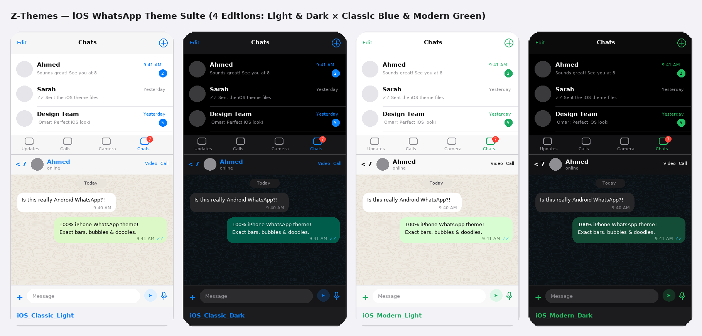

# Z-Themes — حزمة ثيمات واتساب الآيفون (iOS WhatsApp Themes)

حزمة ثيمات متكاملة تحوّل واجهة وتصميم نسخ واتساب المعدّلة (مثل **WhatsApp Gold / واتساب الذهبي**، **Fouad WhatsApp**، **YoWhatsApp**، **GBWhatsApp**، **FMWhatsApp**، **WhatsApp Plus**) إلى تصميم **واتساب الآيفون (WhatsApp for iOS)** بدقة كاملة في كل التفاصيل، وبنفس الصيغة الثلاثية الرسمية لمحرك `GoldThemes` / `YoThemes`:

- `<ThemeName>.xml` — ملف الإعدادات والألوان والتخطيطات بصيغة Android `SharedPreferences`
- `<ThemeName>_w.jpg` — خلفية المحادثة الأصلية لواتساب الآيفون بدقة `1080×1920` (منقّاة بالكامل ومصممة بألوان iOS الأصلية)
- `<ThemeName>_homeW.jpg` — خلفية الشاشة الرئيسية المتوافقة مع `GoldThemes`
- `<ThemeName>.zip` — أرشيف جاهز يضم الملفات الثلاثة معاً لتطبيقه بنقرة واحدة مباشرةً من خيار **تطبيق ثيم من ملف**



---

## الإصدارات الأربعة المتوفرة في مجلد `themes/`

| المجلد | الوضع | الطابع اللوني | أبرز الألوان المعتمدة (Apple HIG) |
| :--- | :--- | :--- | :--- |
| [`themes/iOS_Classic_Light/`](themes/iOS_Classic_Light/) | **الفاتح (Light)** | **أزرق الآيفون الكلاسيكي** | أشرطة `#F6F6F6`، خلفية `#FFFFFF`، أيقونات وتبويبات `#007AFF`، فقاعات مرسلة `#DCF8C6`، فقاعات واردة `#FFFFFF`، وخلفية محادثة بيج دافئة `#EFEAE2` |
| [`themes/iOS_Classic_Dark/`](themes/iOS_Classic_Dark/) | **الداكن (OLED Dark)** | **أزرق الآيفون الكلاسيكي** | خلفية رئيسية سوداء نقية `#000000`، أشرطة `#161618`، أيقونات وتبويبات `#0A84FF`، فقاعات مرسلة `#005C4B`، فقاعات واردة `#262628`، وخلفية محادثة داكنة `#0A1014` |
| [`themes/iOS_Modern_Light/`](themes/iOS_Modern_Light/) | **الفاتح (Light)** | **أخضر واتساب iOS الحديث** | واجهة بيضاء نقية `#FFFFFF`، عناوين حبرية `#0A0A0A`، تمييز أخضر `#1DAB61`، فقاعات مرسلة `#D9FDD3`، وفقاعات واردة `#FFFFFF` |
| [`themes/iOS_Modern_Dark/`](themes/iOS_Modern_Dark/) | **الداكن (OLED Dark)** | **أخضر واتساب iOS الحديث** | خلفية `#000000`، أشرطة `#0B0B0C` / `#121214`، تمييز أخضر `#21C063` مع نص عدّاد داكن عالي التباين، وفقاعات مرسلة `#144D37` |

---

## تفاصيل تصميم واتساب الآيفون المطبّقة تلقائياً

1. **الشريط العلوي والسفلي بنمط iOS الأصلي (`ui_home_styleV3 = ios` & `ui_bottom_style = ios`)**:
   - شريط تبويب سفلي مطابق لواتساب الآيفون تماماً مع دمج المجموعات داخل قائمة الدردشات (`enable_grp_separationV2 = false`) كما في نظام iOS، وشارة تنبيهات حمراء (`#FF3B30` / `#FF453A`) على التبويب السفلي وشارات زرقاء/خضراء لعداد الرسائل في الصفوف.
   - إخفاء الزر العائم الخاص بأندرويد (`hide_fab = true`) وأيقونات الوضع الليلي/الطيران الإضافية للحصول على واجهة آيفون نظيفة 100%.
   - تفعيل السحب يميناً ويساراً على سطر المحادثة (`isSwipeEnabledV2 = true`) والفواصل الدقيقة بين المحادثات (`#E5E5EA` فاتح / `#262629` داكن).
2. **شاشة المحادثة وحقل الكتابة بنمط iOS 14+ (`ConvoEntry = 28`)**:
   - زر الإضافة `+` على اليسار مع فتح قائمة المرفقات السفلية بنمط آيفون (`newAttach_BottomDesign = true`).
   - حقل إدخال كبسولي دائري (`#FFFFFF` في الفاتح و`#2C2C2E` في الداكن) بداخله زر الملصقات/الإيموجي، وبجانبه أزرار الكاميرا والمايكروفون والإرسال بتباين واضح في الحالتين.
   - فقاعات محادثة منحنية الذيل بنمط آيفون (`bubble_style = ios11`) وعلامات صح مزدوجة مطابقة لـ iOS (`tick_style = rcios11`).
   - إخفاء شريط الحالة النصي العائم أسفل اسم جهة الاتصال (`statuschat = true`) مع الإبقاء على الصورة الدائرية وأزرار الاتصال المرئي والصوتي كما في الآيفون تماماً.

---

## طريقة التثبيت والتطبيق في واتساب المعدّل

### الطريقة الأولى: تطبيق ملف `.xml` مع ملفَي الخلفية (نفس صيغة مجلد `GoldThemes`)
1. انسخ الملفات الثلاثة الخاصة بالإصدار الذي تريده معاً إلى مجلد واحد في هاتفك (مثل `Download/GoldThemes/`):
   - `iOS_Classic_Light.xml`
   - `iOS_Classic_Light_w.jpg`
   - `iOS_Classic_Light_homeW.jpg`
   *(مهم: أبقِ الملفات الثلاثة بنفس الاسم الأساسي وفي نفس المجلد حتى يقرأ التطبيق خلفيتَي المحادثة والشاشة الرئيسية تلقائياً).*
2. افتح واتساب المعدّل ← القائمة ← **الإضافات والخصائص (Gold Settings / YoMods / FMMods)** ← **الثيمات (Themes)**.
3. اضغط على **تطبيق ثيم من ملف (Load Theme)**، ثم انتقل إلى المجلد واختر ملف `.xml`.

### الطريقة الثانية: التطبيق المباشر بملف واحد عبر `.zip`
1. حمّل ملف `.zip` الخاص بالإصدار الذي تريده (مثلاً `themes/iOS_Classic_Light/iOS_Classic_Light.zip`).
2. من داخل إعدادات **الثيمات (Themes)** اضغط على **تطبيق ثيم من ملف (Load Theme)** واختر ملف `.zip` مباشرةً — سيقوم التطبيق بفك الضغط وتطبيق الثيم والخلفيات تلقائياً وإعادة تشغيل الواجهة.

> **ملاحظة اختيارية للخط العربي:** يعتمد الثيم خط النظام النظيف بدون زوائد (`Default`) ليطابق خط San Francisco في iOS باللغتين العربية والإنجليزية. وإذا رغبت في خط الآيفون العربي الكلاسيكي المدمج في نسخ واتساب المعدّلة، يمكنك تفعيله من: **الإضافات ← الكل (Universal) ← الستايل (Styles) ← نوع الخط (Font Style) ← `Iphone(Arabic)`**.

---

## التخصيص وإعادة البناء برمجياً

يمكنك تعديل أي لون أو إعداد داخل [`scripts/build_ios_themes.py`](scripts/build_ios_themes.py) ثم إعادة توليد جميع ملفات `.xml` و`_w.jpg` و`_homeW.jpg` و`.zip` وصورة المعاينة بالأمر:

```bash
python3 scripts/build_ios_themes.py
```
